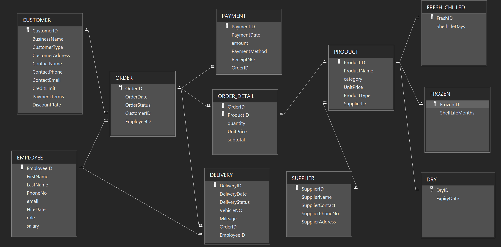
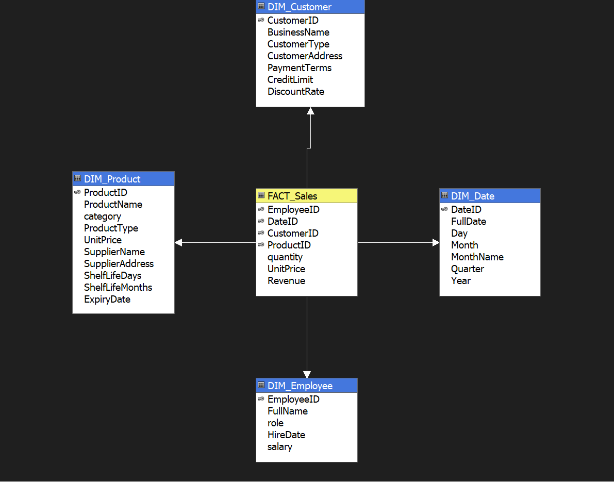
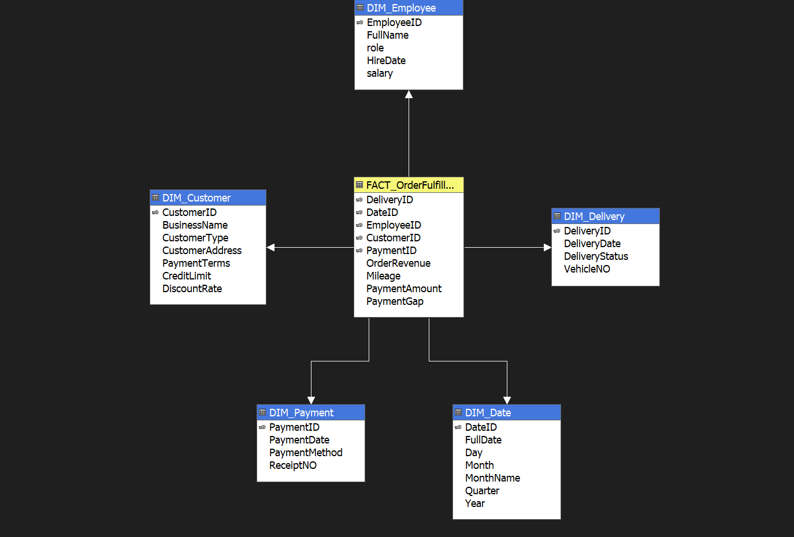

# Joskimu BI System

**An end-to-end business intelligence system for Joskimu, my family's meat distribution business in Nairobi: from a normalized operational database to SSAS cubes and an Excel dashboard.**

*Tools: Microsoft Access · SQL Server 2025 · SSAS (Multidimensional) · Excel PivotTables/PivotCharts*


<!-- TODO: replace with a dashboard screenshot or a simple pipeline diagram -->

## The question

Joskimu supplies fresh, frozen and dry meat products to hotels, hospitals, supermarkets and shops across Nairobi. Its records lived in a transactional database that could show individual orders but couldn't answer cross-cutting questions. My mom knows her best customers by name. I wanted to check whether her gut matched the numbers.

Two business questions drove the design:

1. **Which customers, products and employees drive the most revenue, and when?**
2. **Are high-revenue orders delivered efficiently and paid on time, or do they cost more in mileage and unpaid invoices than they're worth?**

## Data

- **Source:** Joskimu's operational database (Microsoft Access): customers, orders, order lines, products, suppliers, employees, deliveries and payments
- **Size:** a small sample of 19 order lines across 15 orders, Nov 2025 to Mar 2026. Enough to build and test every layer of the pipeline, not enough to draw business conclusions from
- **The records are fictional.** I made up the sample data for this project. Customer names are real Nairobi businesses, used for realism, and employee names are invented. None of the orders, payments or outstanding balances reflect real transactions
- **Not in this repo:** the Access database and Excel workbook. The schema, diagrams, cube definitions, report and screenshots are all here

## Methods

### 1. Operational database (3NF)
An 11-table relational design in third normal form, with referential integrity enforced on every relationship. Products use an **ISA hierarchy** (supertype `PRODUCT` with `FRESH_CHILLED`, `FROZEN` and `DRY` subtypes), and `ORDER_DETAIL` is an **associative entity** with a composite key (`OrderID`, `ProductID`) resolving the many-to-many between orders and products.



### 2. ETL: Access → SQL Server
Dimension and fact tables were shaped with Make Table queries in Access, then loaded into a SQL Server warehouse with the SQL Server Import and Export Wizard. Key transformations:
- **Flattened the ISA hierarchy.** The three product subtypes and `SUPPLIER` were denormalized into one `DIM_Product`. This needed LEFT JOINs: INNER JOINs returned nothing, because each product belongs to exactly one subtype.
- **Built `DIM_Date` from order dates**, with an integer `YYYYMMDD` key the fact tables can derive directly.
- **Rolled order lines up to order level** for the fulfillment fact table and calculated `PaymentGap = OrderRevenue − PaymentAmount` during the load.

### 3. Two star schemas, two grains
The first design was one cube, but delivery mileage and payments live at the **order** level while revenue lives at the **order line** level. Putting them in one fact table would multiply mileage and payment amounts by the number of lines per order (fan-out). So I split it:

| Cube | Grain | Answers | Dimensions | Measures |
|---|---|---|---|---|
| **Sales** | one row per order line | Q1 | Date, Customer, Product, Employee | Revenue, Quantity, Unit Price, Order Line Count |
| **Fulfillment** | one row per order | Q2 | Date, Customer, Employee, Delivery, Payment | Order Revenue, Payment Amount, Payment Gap, Mileage, Order Count |

Date, Customer and Employee are conformed across both cubes, so results can be compared side by side.

| Sales cube | Fulfillment cube |
|---|---|
|  |  |

### 4. SSAS cubes
Built in Visual Studio as an Analysis Services Multidimensional project, with a drill-down hierarchy per dimension (for example Year → Quarter → Month → Day, and Product Type → Category → Product Name, which mirrors the original ISA hierarchy).

### 5. Excel dashboard
Six sheets connected live to the cubes: Executive Summary, Revenue Performance, Sales Depth, Fulfillment Analysis, Payment Behavior, and Raw Data. I designed it for a reader who won't touch a filter, so every sheet has a pre-filtered view and a one-line takeaway.

## Key result

> **The system works end to end, and even on sample data it surfaced the two risks it was built to find: revenue concentration and a payment collection gap.**

- **Concentration:** Fresh/chilled products made up 74% of revenue. One product brought in nearly half of it, and one salesperson closed 59% of sales.
- **Collection:** only 57% of invoiced revenue was collected. The highest-revenue customer also carried the largest unpaid balance.
- **"Worth it?" view:** ranking each customer by revenue, collection rate and delivery mileage together showed that the biggest customer on paper isn't always the most valuable in practice. The transactional database couldn't show this at all.

**Limitations:** the dataset is tiny, so treat these numbers as proof that the pipeline works, not as findings about the business.

## What I'd do differently

- **Freeze the source data before ETL.** I added records after the cubes were built, and reprocessing broke on orphaned foreign keys. Nothing cascades on its own: every layer (Access queries → SQL Server load → cube processing → Excel refresh) has to be rerun by hand.
- **Build shared dimensions once.** The cubes were built one after the other, so I ended up with six dimension objects instead of three. Linked dimensions would have avoided that.
- **Use a full calendar `DIM_Date`.** Deriving it from order dates means months with no orders are missing, which breaks period-over-period calculations.

## View it

- **No install:** [project report (PDF)](docs/report.pdf) · [presentation (PDF)](docs/presentation.pdf) · dashboard screenshots in `figures/`
- **To rebuild:** run `01-operational-db/schema.sql` and `03-warehouse/star-schema.sql` on SQL Server, open `04-cubes/` in Visual Studio with the Analysis Services extension, point the data source at your server, and process

## Repo layout

```
├── docs/                 # report and presentation (PDF)
├── figures/              # ERD, star schemas, dashboard screenshots
├── 01-operational-db/    # 3NF schema script + table definitions
├── 02-etl/               # ETL notes and transformation queries
├── 03-warehouse/         # star schema DDL
├── 04-cubes/             # SSAS multidimensional project
└── 05-dashboard/         # dashboard screenshots
```

---
*Brenda Kinoti · [Portfolio](https://brendakinoti-datascientist.netlify.app) · MS Data Analytics & Business, Seattle Pacific University*
